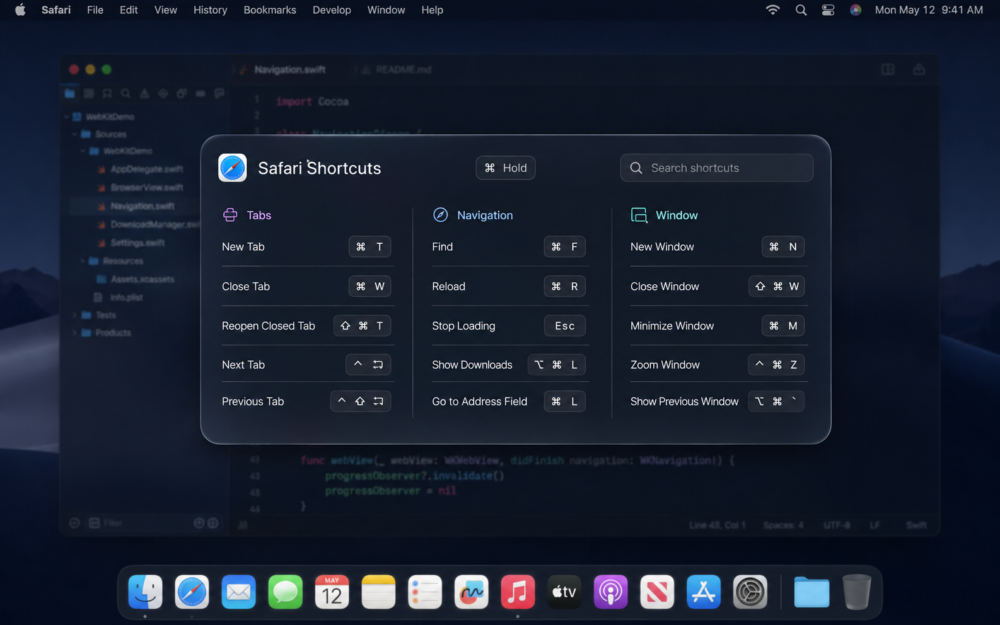

# Keyveil

> Hold Command. Reveal every shortcut.

Keyveil is a lightweight macOS menu bar utility inspired by CheatSheet. Hold the `Command` key and Keyveil reads the active app's menus, then presents its keyboard shortcuts in a clean Liquid Glass overlay. Release `Command` to dismiss it.



## Features

- Detects a long press of either `Command` key anywhere in macOS
- Double-tap `Command` to pin the overlay and browse without holding a key
- Reads shortcuts from the frontmost app through the macOS Accessibility API
- Groups shortcuts by their native menu sections
- Ignores normal combinations such as `Command-C`, so they do not open the overlay
- Uses native Liquid Glass on macOS 26 and a system material fallback on macOS 14–15
- Uses a large adaptive 2–3 column shortcut wall with continuous vertical scrolling, adjustable hold delay, multi-display placement, and full-screen Space support
- Caches each app's shortcuts for fast repeat display and safely ignores stale background reads
- Preserves temporarily disabled menu shortcuts and displays them with reduced emphasis
- Runs as a small menu bar app without a Dock icon

## Requirements

- macOS 14 or later
- Swift 6.2 or later to build from source
- Accessibility permission, used only to read menu titles and shortcut metadata

Keyveil does not record keystrokes, window content, or typed text. The global event tap only observes modifier changes and cancels itself when another key is pressed.

## Controls

- Hold `Command`: show Keyveil temporarily
- Release `Command`: close the temporary overlay
- Double-tap `Command`: pin or unpin Keyveil
- `Escape`: close a pinned overlay
- Keep holding `Command` and use two-finger vertical scrolling over the panel to browse more shortcuts

## Build

Build the executable with Swift Package Manager:

```bash
swift build -c release
```

Create a signed local `.app` bundle:

```bash
./scripts/package-app.sh release
open dist/Keyveil.app
```

On first launch, Keyveil presents a non-floating setup window for its two required permissions. Choosing **Allow** dismisses Keyveil before macOS presents the authorization interface, so the setup window never covers System Settings.

Enable Keyveil in both locations if macOS asks:

- **System Settings → Privacy & Security → Accessibility**
- **System Settings → Privacy & Security → Input Monitoring**

If a locally rebuilt copy stops responding to Command, remove its old entries from both lists, add the current app again, and relaunch. Ad-hoc development signatures change between builds.

## Development preview

To inspect the UI with deterministic sample data without granting Accessibility access:

```bash
swift run Keyveil --preview
```

Preview the first-launch permission UI without automatically requesting permissions:

```bash
swift run Keyveil --preview-permissions
```

The original browser-based interaction study is preserved in [`DesignPrototype`](DesignPrototype/).

## Architecture

```text
CommandHoldMonitor
        │ long hold / release
        ▼
    AppDelegate ─── frontmost app ─── NSWorkspace
        │
        ├── menu shortcuts ────────── AccessibilityShortcutService
        │
        └── presentation ──────────── NSPanel + SwiftUI Liquid Glass
```

## Privacy

All processing stays on the Mac. Keyveil has no analytics, network client, account system, or cloud service.

## License

MIT
