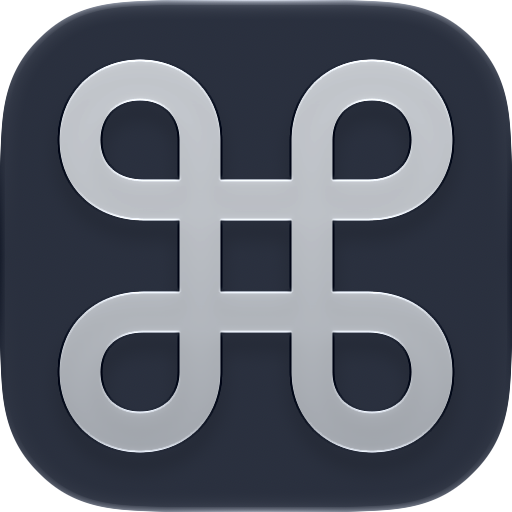
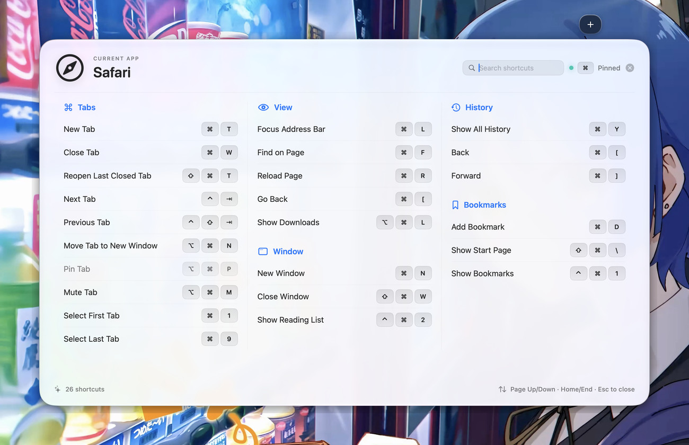
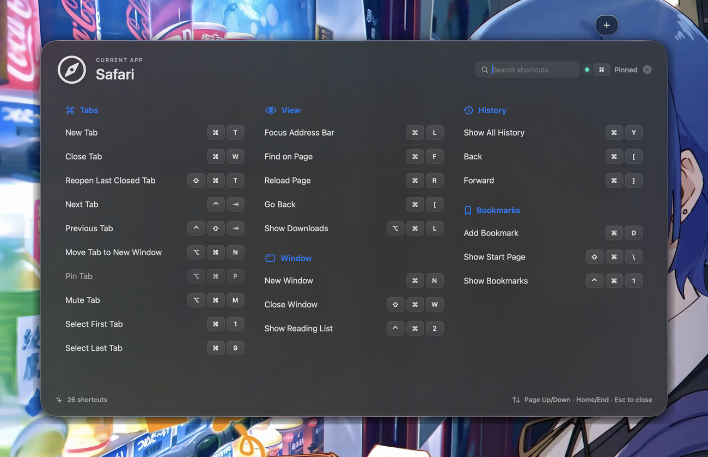
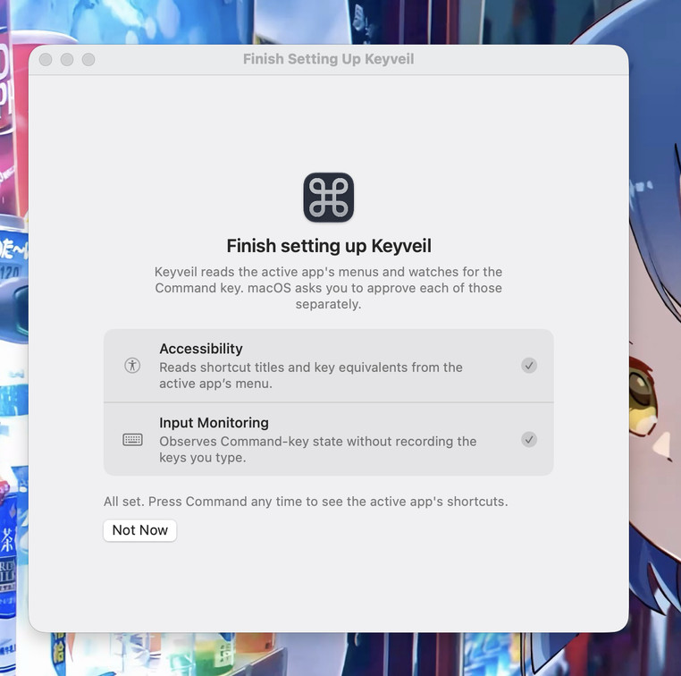

<div align="center">



# Keyveil

**Hold ⌘. Reveal every shortcut.**
**按住 ⌘，看清每一个快捷键。**

[](#requirements)
[](#build-from-source)
[](LICENSE)
[](#-简体中文)
[](#permissions-and-privacy)

[English](#english) · [简体中文](#简体中文)



</div>

---

## English

Keyveil is a small macOS menu bar app. Hold **⌘** and it reads the frontmost app's menus through the Accessibility API, then lays every shortcut out in a Liquid Glass panel. Let go and it disappears. It is the idea behind CheatSheet, rebuilt for modern macOS: layered glass, an adaptive multi-column wall, folding menus, and search.

### Screenshots

| Dark appearance | First-run setup |
| --- | --- |
|  |  |

### Features

**Activation**

- Detects a long press of either `Command` key anywhere in macOS; ordinary combinations such as `⌘C` never open the panel
- Double-tap `Command` to pin the panel and browse without holding a key
- Adjustable hold duration, optional launch at login, and no Dock icon

**The wall**

- Shortcuts keep their native menu sections and are laid out in 2–3 adaptive columns with continuous vertical scrolling
- Long menus fold down to the rows that fit on screen, with an inline control to reveal the rest, so one crowded menu cannot push the wall out of view
- Everything AppKit gives every app — the window arrangement block and the global commands — is collected into a single folded **Common** group, so the first screen is the app's own features
- A search field filters by shortcut name, key, or both together (`⇧⌘P`) without stealing focus from the app you are working in
- Paints an appearance-matched base under the glass and draws its own outline and shadow, so the text stays readable over a white document or a busy desktop instead of inheriting its contrast from whatever is behind the panel
- Native Liquid Glass on macOS 26 and later, a system material fallback on macOS 14–15
- Multi-display placement and full-screen Space support

**State you can trust**

- A status light reports what the wall is showing: green for a clean scan, orange for earlier results, red when nothing could be read, dim while a scan runs
- Per-app caching for instant repeat display, cache invalidation from live Accessibility menu notifications, and debounced refreshes of pinned results
- Empty menus, unavailable apps, and timed-out scans are distinct, retryable states
- Menu shortcuts that are temporarily disabled stay visible, at reduced emphasis

**Platform**

- English and Simplified Chinese throughout the app
- Rebuilds its global monitor after sleep, screen wake, and fast-user-switching session changes
- No analytics, no network client, no account system

### Requirements

- macOS 14 or later
- Xcode 26 or Swift 6.2 or later to build from source; full Xcode is required to run the test suite
- **Accessibility** permission, used only to read menu titles and shortcut metadata
- **Input Monitoring** permission, used only to observe Command-key state

### Install

1. Build the app bundle and its zip:
   ```bash
   git clone https://github.com/Capt-Lappland/Keyveil.git
   cd Keyveil
   ./scripts/package-app.sh release
   ```
2. Unzip `dist/Keyveil.zip`, move `Keyveil.app` to `/Applications`, and launch it there. Ad-hoc development signatures change between builds, so running it from your build directory and then from `/Applications` makes macOS treat it as a different app.
3. Grant both permissions when Keyveil asks, in **System Settings → Privacy & Security**:
   - **Accessibility** — read the active app's menu titles and key equivalents
   - **Input Monitoring** — watch the Command key

If a rebuilt copy stops responding to `Command`, remove its old entries from both lists, add the current app again, and relaunch.

### Controls

| Action | Result |
| --- | --- |
| Hold `Command` | Show the panel while held |
| Release `Command` | Close it |
| Double-tap `Command` | Pin or unpin the panel |
| `Escape` | Close a pinned panel |
| Type in the search field | Filter by name, key, or both; clear it to show everything again |
| `↑` `↓` · `Page Up` `Page Down` · `Home` `End` | Browse a pinned panel (while the search field has focus these keys edit the query instead) |
| Scroll while holding `Command` | Scroll the wall |
| **Show N more** / header chevron | Unfold or fold a long menu |

Fold and **Common**-group choices are remembered for the session, so a group you open in one app stays open in the next.

Keyveil reveals the shortcuts an app publishes in its own menu bar. Shortcuts that exist only inside a window, a canvas, or a settings pane are not visible to any menu reader, including this one.

### Permissions and privacy

All processing stays on the Mac. Keyveil has no analytics, no network client, no account system, and no cloud service. The global event tap only observes modifier changes and cancels itself when another key is pressed — it does not record keystrokes, window content, or typed text.

Runtime diagnostics go to Apple's unified logging system and contain only timings, counts, and state transitions — never application names, menu titles, or pressed keys:

```bash
log stream --predicate 'subsystem == "app.keyveil.mac"'
```

### Build from source

```bash
swift build -c release
```

If this checkout lives in `~/Documents`, iCloud Drive or another file provider can attach `FinderInfo` to freshly built bundles, which makes `codesign` refuse them. Point the build directory somewhere outside the synced folder:

```bash
swift build --scratch-path /tmp/keyveil-build
```

Create an ad-hoc signed universal `.app` bundle and its canonical local zip artifact:

```bash
./scripts/package-app.sh release
open dist
```

The script builds both Apple silicon and Intel slices, then verifies the extracted archive. It intentionally produces only `dist/Keyveil.zip`, because a synced `Documents` folder can attach Finder metadata to a raw app and invalidate its signature.

Local packages are ad-hoc signed by default. Set `CODESIGN_IDENTITY` to a *Developer ID Application* identity to enable hardened-runtime signing; a public download also has to be notarized and stapled with your Apple Developer credentials.

### Development previews

Inspect the UI with deterministic sample data, without granting Accessibility access:

```bash
swift run Keyveil --preview                 # the shortcut wall
swift run Keyveil --preview-permissions     # the first-run setup window
swift run Keyveil --preview-settings        # the preferences window
swift run Keyveil --preview --preview-language=zh-Hans   # force a language
```

### Testing

```bash
swift test --scratch-path /tmp/keyveil-build -Xswiftc -warnings-as-errors
```

80 unit, state, gesture, layout, and rendering tests. The rendering suite can also export its snapshots for visual review:

```bash
mkdir -p /tmp/keyveil-snapshots
KEYVEIL_SNAPSHOT_DIR=/tmp/keyveil-snapshots swift test --filter ShortcutPanelRenderingTests
```

### Architecture

```text
CommandHoldMonitor
        │ long hold / release
        ▼
    AppDelegate ─── frontmost app ─── NSWorkspace
        │
        ├── menu shortcuts ────────── AccessibilityShortcutService
        │
        └── presentation ──────────── NSPanel + SwiftUI Liquid Glass
```

| Area | Files |
| --- | --- |
| Lifecycle, status item, panel and window controllers | `AppDelegate.swift`, `KeyveilApp.swift` |
| State and layout model | `Models.swift`, `ShortcutWallPlan.swift`, `SystemShortcutCatalog.swift` |
| Input and menu reading | `Services/CommandHoldMonitor.swift`, `Services/AccessibilityShortcutService.swift`, `Services/AccessibilityMenuObserver.swift` |
| Interface | `Views/ShortcutPanelView.swift`, `Views/SettingsView.swift`, `Views/PanelSurfaceView.swift`, `Views/PermissionSetupView.swift` |
| Localization | `Localization.swift`, `Resources/*.lproj` |

Keyveil deliberately has no SwiftUI `Settings` scene: on macOS 26 its window was never ordered on screen, so the preferences window is built by an `NSWindowController` whose presentation can actually be checked.

### App icon

The icon is an [Icon Composer](IconAssets/Keyveil.icon) document built from one deterministic geometric Command-symbol layer — no generative imagery. `scripts/build-icon.sh` renders it with Xcode's own `ictool` and packs `IconAssets/Keyveil.icns` with `iconutil`; the artwork source is `IconAssets/command-symbol.svg`, rasterized by `scripts/render-icon-layer.swift`.

The build defaults to a full-bleed canvas (`GRID=1024`), which is what macOS 26 and later expect; `GRID=824` produces the classic pre-Tahoe grid for macOS 14–15, which draws the `.icns` as-is. See the comments at the top of the script for the measurements behind that choice.

### License

MIT — see [LICENSE](LICENSE).

---

## 简体中文

Keyveil 是一个小巧的 macOS 菜单栏应用。按住 **⌘**，它会通过辅助功能接口读取当前应用的菜单，把其中所有快捷键铺在一块液态玻璃面板上；松手即收起。可以理解为面向现代 macOS 重做的 CheatSheet：分层玻璃、自适应多列视图、菜单折叠、搜索。

### 截图

| 深色外观 | 首次启动引导 |
| --- | --- |
|  |  |

### 功能

**唤起方式**

- 在任意位置长按左右任意一个 `Command` 键即唤起；`⌘C` 这类普通组合键不会误触发
- 双击 `Command` 可以把面板钉住，不用一直按着键就能浏览
- 长按时长可调，可设为登录时静默启动，不占 Dock

**快捷键视图**

- 快捷键保留应用原本的菜单分组，按 2–3 列自适应排布，可连续纵向滚动
- 过长的菜单只显示放得下的那几行，就地展开剩余部分，单个臃肿的菜单不会把整块视图挤出屏幕
- AppKit 给每个应用都加上的那些（窗口排布、全局命令）统一收进末尾折叠的 **Common** 分组，第一屏留给应用自己的功能
- 搜索框可按名称、按键或两者组合（如 `⇧⌘P`）筛选，且不会把焦点从你正在用的应用抢走
- 玻璃下面自带一层跟随外观的底色，并自绘描边与投影，所以压在白文档或花哨桌面上文字依然清楚，而不是被动继承背后的对比度
- macOS 26 及以上用原生液态玻璃，macOS 14–15 回退到系统材质
- 支持多显示器定位与全屏空间

**状态可信**

- 状态灯说明当前看到的是什么：绿色为刚扫描完成，橙色为屏幕上是早先的结果，红色为读不到内容，变暗表示正在扫描
- 按应用缓存，重复唤起秒开；监听辅助功能菜单通知让缓存失效，钉住的结果延迟防抖刷新
- 空菜单、应用不可读、扫描超时是三种不同且可重试的状态
- 被临时禁用的菜单快捷键仍然显示，只是淡化

**平台**

- 应用内全量支持英文与简体中文
- 睡眠、唤醒、快速用户切换后会重建全局监听
- 没有统计上报、没有网络请求、没有账号体系

### 环境要求

- macOS 14 或更高版本
- 从源码构建需要 Xcode 26 或 Swift 6.2 及以上；跑测试套件需要完整 Xcode
- **辅助功能**权限：只用来读取菜单标题与快捷键信息
- **输入监控**权限：只用来观察 Command 键状态

### 安装

1. 构建应用包与 zip：
   ```bash
   git clone https://github.com/Capt-Lappland/Keyveil.git
   cd Keyveil
   ./scripts/package-app.sh release
   ```
2. 解压 `dist/Keyveil.zip`，把 `Keyveil.app` 移到 `/Applications` 再启动。本地临时签名每次构建都会变，先在构建目录里跑过一次、再换到 `/Applications`，macOS 会当成两个不同的应用。
3. 按 Keyveil 的提示，在 **系统设置 → 隐私与安全性** 里授两项权限：
   - **辅助功能** —— 读取当前应用的菜单标题与快捷键
   - **输入监控** —— 观察 Command 键

如果重新构建后按 `Command` 没反应，把两个列表里的旧条目删掉，重新添加当前这个应用，再重启。

### 操作方式

| 操作 | 效果 |
| --- | --- |
| 按住 `Command` | 按住期间显示面板 |
| 松开 `Command` | 收起 |
| 双击 `Command` | 钉住 / 取消钉住面板 |
| `Escape` | 关闭已钉住的面板 |
| 在搜索框输入 | 按名称、按键或组合筛选；清空即恢复全部 |
| `↑` `↓` · `Page Up` `Page Down` · `Home` `End` | 浏览已钉住的面板（搜索框获得焦点时这些键用于编辑查询） |
| 按住 `Command` 时滚动 | 滚动视图 |
| **Show N more** / 标题栏箭头 | 展开或折叠过长的菜单 |

折叠状态与 **Common** 分组的开合会记在本次会话里：在某个应用中展开的分组，切到下一个应用仍然是展开的。

Keyveil 只能看到应用写在菜单栏里的快捷键。只存在于窗口内、画布内或设置面板里的快捷键，任何菜单读取工具都看不到，它也看不到。

### 权限与隐私

所有处理都在本机完成。Keyveil 没有统计上报、没有网络客户端、没有账号体系，也不连任何云服务。全局事件监听只观察修饰键变化，一旦按下其它键就自行取消——它不记录按键、窗口内容或输入的文字。

运行日志走 Apple 的统一日志系统，只包含耗时、数量和状态变化，绝不包含应用名、菜单标题或按下的键：

```bash
log stream --predicate 'subsystem == "app.keyveil.mac"'
```

### 从源码构建

```bash
swift build -c release
```

如果这个仓库放在 `~/Documents` 下，iCloud 云盘或其它文件提供程序可能给新构建的 bundle 加上 `FinderInfo`，导致 `codesign` 拒绝签名。把构建目录指到同步目录之外：

```bash
swift build --scratch-path /tmp/keyveil-build
```

生成临时签名的通用 `.app` 与本地分发用的 zip：

```bash
./scripts/package-app.sh release
open dist
```

脚本会同时构建 Apple 芯片与 Intel 两个架构，并校验解压出来的包。它刻意只产出 `dist/Keyveil.zip`：同步盘上的 `Documents` 会给裸 `.app` 附上 Finder 元数据，从而破坏签名。

本地包默认使用临时签名。把 `CODESIGN_IDENTITY` 指向 *Developer ID Application* 证书即可启用强化运行时签名；要公开发布还需要用你的 Apple 开发者凭据完成公证（notarize）与装订（staple）。

### 开发预览

不授予辅助功能权限，也能用固定样本数据查看界面：

```bash
swift run Keyveil --preview                 # 快捷键面板
swift run Keyveil --preview-permissions     # 首次启动引导窗口
swift run Keyveil --preview-settings        # 偏好设置窗口
swift run Keyveil --preview --preview-language=zh-Hans   # 强制指定语言
```

### 测试

```bash
swift test --scratch-path /tmp/keyveil-build -Xswiftc -warnings-as-errors
```

共 80 项单元、状态、手势、布局与渲染测试。渲染测试套件还可以导出截图用于人工检查：

```bash
mkdir -p /tmp/keyveil-snapshots
KEYVEIL_SNAPSHOT_DIR=/tmp/keyveil-snapshots swift test --filter ShortcutPanelRenderingTests
```

### 结构

```text
CommandHoldMonitor
        │ 长按 / 松开
        ▼
    AppDelegate ─── 当前应用 ─── NSWorkspace
        │
        ├── 菜单快捷键 ────────── AccessibilityShortcutService
        │
        └── 界面呈现 ──────────── NSPanel + SwiftUI 液态玻璃
```

| 部分 | 文件 |
| --- | --- |
| 生命周期、状态栏图标、面板与窗口控制器 | `AppDelegate.swift`、`KeyveilApp.swift` |
| 状态与布局模型 | `Models.swift`、`ShortcutWallPlan.swift`、`SystemShortcutCatalog.swift` |
| 输入监听与菜单读取 | `Services/CommandHoldMonitor.swift`、`Services/AccessibilityShortcutService.swift`、`Services/AccessibilityMenuObserver.swift` |
| 界面 | `Views/ShortcutPanelView.swift`、`Views/SettingsView.swift`、`Views/PanelSurfaceView.swift`、`Views/PermissionSetupView.swift` |
| 本地化 | `Localization.swift`、`Resources/*.lproj` |

Keyveil 刻意不用 SwiftUI 的 `Settings` 场景：在 macOS 26 上它的窗口根本不会被显示出来，所以偏好设置窗口由一个可以实际验证显示结果的 `NSWindowController` 构建。

### 应用图标

图标是一份 [Icon Composer](IconAssets/Keyveil.icon) 文档，来自同一个几何 Command 符号图层，没有使用任何生成式图像。`scripts/build-icon.sh` 调用 Xcode 自带的 `ictool` 渲染，再用 `iconutil` 打包成 `IconAssets/Keyveil.icns`；图形源文件是 `IconAssets/command-symbol.svg`，由 `scripts/render-icon-layer.swift` 栅格化。

构建默认使用满幅画布（`GRID=1024`），这是 macOS 26 及以上期望的形式；`GRID=824` 生成适配 macOS 14–15 的经典网格（旧系统会原样绘制 `.icns`）。这样取舍的依据写在脚本开头的注释里。

### 许可

MIT，详见 [LICENSE](LICENSE)。
